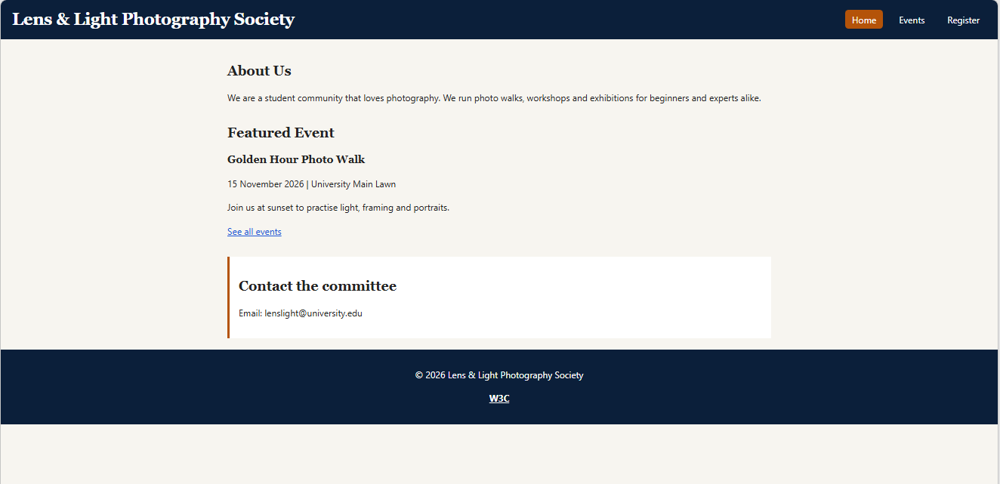

# cit331-assignment1-0020
CIT331 Assignment 1

# Lens & Light Photography Society

Lens & Light is a student photography club for anyone who enjoys capturing the world around them, whether they shoot with a professional camera or just a phone. We run photo walks, hands-on workshops and an annual exhibition, so beginners can learn the basics and experienced members can share their work. This website lists our upcoming events and lets students register online.

## Pages

- index.html: Home page with club description and featured event
- events.html: List of upcoming events
- register.html: Registration form and saved registrations

## Image Sources

- images/photo-walk.jpg: Photo by Britt Weckx on Unsplash (https://unsplash.com/@weckxke), used on the Events page. Free to use under the Unsplash License.
  **

## How to open locally**

1. Download or clone this repository.
2. Open the folder and double-click `index.html`.
3. The site opens in your browser. Use the menu to visit the other pages.

## Screenshot

## Live site

https://beenishkashifpk-cloud.github.io/cit331-assignment1-0020/
## Vercel link
https://cit331-assignment1-0020.vercel.app
